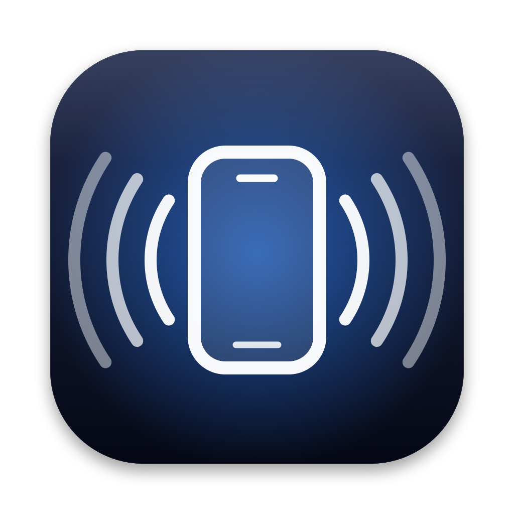

<p align="center">
  
</p>

<h1 align="center">Android Mirroring</h1>

<p align="center">
  See and control your Android phone from your Mac, Windows PC or Linux desktop.<br>
  Over USB or Wi-Fi. No account, no cloud. Native on macOS (no Electron).
</p>

Android Mirroring is a pure AppKit front end for [scrcpy](https://github.com/Genymobile/scrcpy). It talks to your phone through `adb`, plays the video with AVFoundation and shows it in a floating, frameless window that feels like a Mac app: pair once with a code, then connect with one click.

## Features

- **Mirror and control**: click, drag, scroll and type on the Mac. Right-click sends Back. ⌘V pastes your Mac clipboard into the phone.
- **Wireless or USB**: plugged-in phones show up automatically. For Wi-Fi, pair once with the pairing code, then just Connect.
- **Floating controls**: Home, App Switcher, Notifications and a "…" menu, in a bar that appears when you move the pointer to the top and fades away otherwise. Drag the bar to move the window.
- **Phone Screen Off**: turn the phone's own screen off while mirroring keeps running (⌥⌘L). The screen is switched back on when you disconnect or quit.
- **Sound where you want it**: keep audio on the phone, or play it on the Mac.
- **Drop files onto the window**: `.apk` files are installed, everything else is copied to the phone's Downloads folder (a file with the same name is kept, the new one becomes `name (1)`).
- **Keep on Top**: the window floats above other apps and follows you across Spaces (⌥⌘T).
- **Resizable, aspect-locked window**: drag any edge or corner; Zoom In / Out / Actual Size / Fit from the View menu. Rotation is followed automatically.
- **Respects reduced motion** and uses system accent colors, SF Symbols and Apple-style spacing.

### Keyboard shortcuts

| Shortcut | Action |
| --- | --- |
| ⌘1 | Home |
| ⌘2 | App Switcher |
| ⌘3 | Notifications (press again to close) |
| ⌘[ | Back (or right-click, or Esc) |
| ⌘0 / ⌘+ / ⌘− / ⌘9 | Actual size / zoom in / zoom out / fit |
| ⌘⌥L | Phone Screen Off |
| ⌘⌥T | Keep on Top |
| ⌘D | Disconnect |
| ⌥-drag on the phone screen | Move the window |

## Download

Ready-made builds are on the [Releases](https://github.com/zaluchufinley/androidmirroring/releases) page: a `.dmg` for macOS (Apple Silicon and Intel), `.exe` installers for Windows (x64 and ARM64), and an `.AppImage` plus an Arch `.pacman` package for Linux (x64). None is signed or notarized, so the first launch needs one extra click: on macOS right-click the app and choose **Open** (or `xattr -dr com.apple.quarantine "/Applications/Android Mirroring.app"`); on Windows choose **More info**, then **Run anyway**; on Linux make the AppImage executable with `chmod +x`. Releases are built by GitHub Actions when a tag like `v1.0.0` is pushed.

## Windows and Linux

There is also a Windows and Linux version in [`windows/`](windows/). It is a separate app (Electron and WebCodecs) that speaks the same scrcpy protocol and has the same features and look. It bundles `adb` and the scrcpy server, so there is nothing to install. The macOS app stays native and dependency-free. See [windows/README.md](windows/README.md) for building, testing and trying it in a VM.

### Linux (x64)

- **Arch Linux and Arch-based distros:** install the `.pacman` package with `sudo pacman -U Android-Mirroring-<version>-x64.pacman`, or use the AppImage (it needs `fuse2`: `sudo pacman -S fuse2`).
- **Bazzite** (and other Fedora Atomic / Universal Blue images): download the `.AppImage`, `chmod +x` it and run it, or add it with Gear Lever. Nothing is layered onto the system.
- Wireless debugging works out of the box. For USB, install your distro's Android udev rules if the phone does not show up.
- The AppImage is tested on Arch and Bazzite. Other distros may work, but Ubuntu 23.10 and newer blocks Electron's sandbox by default and needs `--no-sandbox`.

## Requirements

- macOS 14 or later
- Xcode Command Line Tools (for `swiftc`): `xcode-select --install`
- [Homebrew](https://brew.sh) packages `scrcpy` and `android-platform-tools`
- An Android phone with **Developer options** and **USB debugging** (or **Wireless debugging**, Android 11+) turned on

```sh
brew install scrcpy
brew install --cask android-platform-tools
```

> The app starts the scrcpy server that ships with your installed scrcpy, and the server only runs when its version matches exactly. If you upgrade scrcpy with Homebrew, nothing else needs to change: the app reads the version at launch.

## Build and run

```sh
git clone https://github.com/zaluchufinley/androidmirroring.git
cd androidmirroring
./build.sh
open "Android Mirroring.app"
```

`build.sh` compiles the sources with `swiftc`, writes the `Info.plist`, adds the icon and ad-hoc signs the app. There is no Xcode project. If macOS refuses to open it the first time, right-click the app and choose **Open**.

## Connecting your phone

### USB

1. Enable **Developer options** and **USB debugging** on the phone.
2. Plug it in and accept the "Allow USB debugging?" prompt.
3. The phone appears under **Phones**. Click it.

### Wi-Fi (Android 11+)

Your Mac and phone must be on the same network.

1. On the phone, open **Developer options › Wireless debugging** and turn it on.
2. In the app, click **Pair a New Phone**.
3. On the phone, tap **Pair device with pairing code**. It shows an address like `192.168.0.101:34223` and a 6-digit code.
4. Enter that address and code in the app and click **Pair**. Both change every time the dialog is reopened.
5. Back on the **Connect** screen, enter the address from the *main* Wireless debugging screen (a different port, like `192.168.0.101:43453`) and click **Connect**.

After the first pairing you only need step 5. The connect port changes whenever Wireless debugging is switched off and on again.

## Troubleshooting

**"No route to host" or the phone is never found over Wi-Fi.** macOS can block a long-running `adb` server from reaching devices on your local network (System Settings › Privacy & Security › Local Network). Restarting the server from Terminal usually fixes it:

```sh
adb kill-server && adb start-server
```

**"Couldn't pair".** Pairing needs the address and code from the *pairing* dialog, not the main Wireless debugging screen, and the dialog must stay open. To see adb's real message, run `adb pair <address> <code>` in Terminal.

**The phone doesn't show up over USB.** Run `adb devices`. `unauthorized` means you need to accept the prompt on the phone. An empty list usually means a charge-only cable.

**Phone Screen Off and the phone sleeps.** Turning the screen off only switches off the display; the phone still follows its normal screen timeout and can lock or sleep, which pauses the mirror. Keep it charging, or raise the screen timeout.

## How it works

The app pushes scrcpy's server to the phone with `adb`, forwards a local port to it, and speaks the scrcpy protocol directly: an H.264 video stream goes to an `AVSampleBufferDisplayLayer`, optional raw audio goes to `AVAudioEngine`, and input goes back as scrcpy control messages (touch, scroll, keys, text, clipboard, notification panel, display power).

```
Sources/
  main.swift      App delegate, window, menus, connect/pair/session flow
  Core.swift      adb and socket helpers, scrcpy control protocol, H.264 and audio, mirror session
  UI.swift        Chrome bar, mirror view and input, resize handles, root view
  Connect.swift   The connect and pairing screens
  Transfer.swift  Dropped files: APK install and push to Downloads
Resources/        App icon
tools/            Icon generator (make_icon.swift)
tests/swift/      Golden-byte tests for the Swift control protocol and file naming
windows/          The Windows and Linux app (Electron), with its own tests and README
build.sh          Builds "Android Mirroring.app"
```

## Contributing

Issues and pull requests are welcome. The project is intentionally small and dependency-free: a handful of Swift files and a build script. Please keep it that way, and describe how you tested a change with a real phone. Run the tests before you open a pull request: `cd windows && npm ci && npm test` for the Windows/Linux app, and for the Swift side `swiftc -o /tmp/swifttests Sources/Core.swift Sources/Transfer.swift tests/swift/main.swift -framework AppKit -framework AVFoundation -framework CoreMedia && /tmp/swifttests`.

## Credits

Built on top of [scrcpy](https://github.com/Genymobile/scrcpy) by Genymobile (Apache 2.0) and Google's Android Debug Bridge. Not affiliated with either project.
